# 🔮 AlchEx — Complete Project Architecture Guide

> **AlchEx** = **Alch**emy + **Ex**change — A Non-Monetary Student Exchange Platform  
> **Team**: Ahmad Mursaleen (24L-0664), Shajee Haroon (24L-0559), Abdur Rehman Shah (24L-0712)  
> **Course**: Database Systems — Spring 2026, FAST-NUCES Lahore  
> **Instructor**: Ahmed Jaan | **Lab TA**: Shahzeb Mubashar

---

## 📌 What is AlchEx? (The Elevator Pitch)

AlchEx is a **cashless digital marketplace exclusively for university students**. Instead of using money, students exchange goods and services directly — inspired by the alchemical principle of **"Equivalent Exchange"** (you can't gain something without giving something in return).

**Example**: A student posts *"I need help with Calculus — I'll design your resume in return."* Another student sees this, makes an offer, they agree, chat to coordinate, complete the exchange, and rate each other.

---

## 🏗️ High-Level Architecture

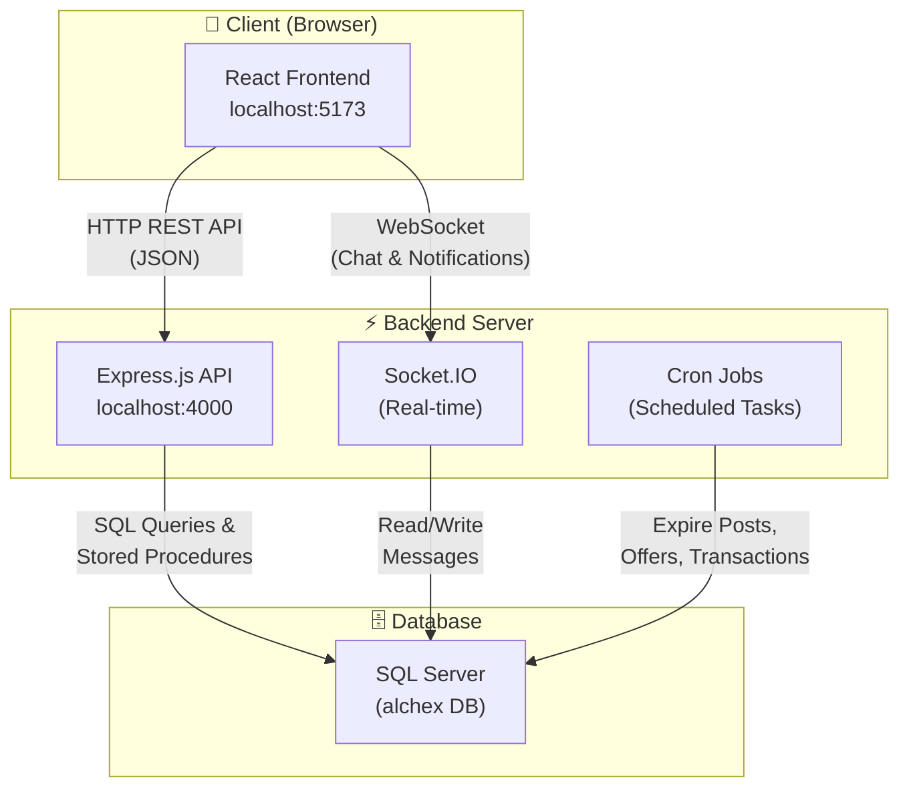

### What Each Part Does

| Component | Technology | Purpose |
|-----------|-----------|---------|
| **Frontend** | React + Vite + TypeScript | The UI that students see and interact with in the browser |
| **Backend API** | Node.js + Express + TypeScript | Processes all business logic, handles HTTP requests |
| **WebSocket** | Socket.IO | Powers real-time chat, typing indicators, notifications |
| **Database** | SQL Server | Stores all data (users, posts, offers, transactions, etc.) |
| **Cron Jobs** | node-cron | Automatically expires old posts/offers/transactions on a schedule |

---

## 📂 Project Folder Structure

```
AlchEx/
├── backend/                    ← Server-side code
│   ├── sql/                    ← Raw SQL files
│   │   ├── schema.sql          ← Table definitions (CREATE TABLE)
│   │   ├── stored_procedures.sql ← 14 stored procedures
│   │   ├── views.sql           ← SQL views
│   │   └── queries.sql         ← Sample queries
│   ├── src/
│   │   ├── server.ts           ← 🚀 ENTRY POINT — starts Express
│   │   ├── controllers/        ← Handle HTTP requests
│   │   ├── services/           ← Business logic
│   │   ├── repositories/       ← Database queries
│   │   ├── routes/             ← URL endpoint definitions
│   │   ├── middlewares/        ← Auth, validation, error handling
│   │   ├── sockets/            ← Real-time chat via Socket.IO
│   │   ├── jobs/               ← Scheduled cron jobs
│   │   ├── db/                 ← Database connection + seeding
│   │   └── utils/              ← JWT, config, validators, helpers
│   └── package.json
│
├── frontend/                   ← Client-side code
│   ├── src/
│   │   ├── App.tsx             ← 🚀 ENTRY POINT — all routes
│   │   ├── main.tsx            ← React DOM render
│   │   ├── pages/              ← Full page components (16 pages)
│   │   ├── components/
│   │   │   ├── ui/             ← Reusable UI (Button, Modal, etc.)
│   │   │   ├── layout/         ← Sidebar, Header, AppLayout
│   │   │   └── landing/        ← 3D hero scene
│   │   ├── services/           ← API client, auth, socket
│   │   ├── store/              ← Zustand state management
│   │   ├── types/              ← TypeScript interfaces
│   │   └── index.css           ← Global styles
│   └── package.json
│
├── docker-compose.yml          ← Docker setup (optional)
├── start.ps1                   ← One-click setup script
└── run.ps1                     ← Quick start script
```

---

## 🔄 Backend Architecture (Layered Pattern)

The backend follows a **strict 4-layer architecture**. Each layer has ONE job:

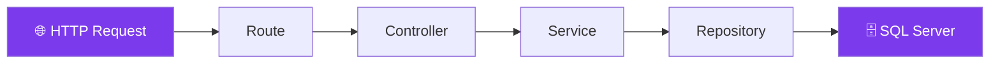

### What Each Layer Does

| Layer | Files | Responsibility | Example |
|-------|-------|---------------|---------|
| **Routes** | `routes/*.ts` | Maps URLs to controllers | `POST /api/auth/login` → `authController.login` |
| **Controllers** | `controllers/*.ts` | Reads request data, calls service, sends response | Extracts email/password from body, calls `authService.login()` |
| **Services** | `services/*.ts` | **All business logic lives here** — validation, authorization, orchestration | Checks if user exists, verifies password, generates JWT tokens |
| **Repositories** | `repositories/*.ts` | **Only** talks to the database — pure SQL queries | `SELECT * FROM users WHERE email = @email` |

> [!IMPORTANT]
> **Why layered?** Each layer only calls the one below it. Controllers never touch the database directly. This makes the code organized, testable, and easy to modify.

### Concrete Example: Login Flow

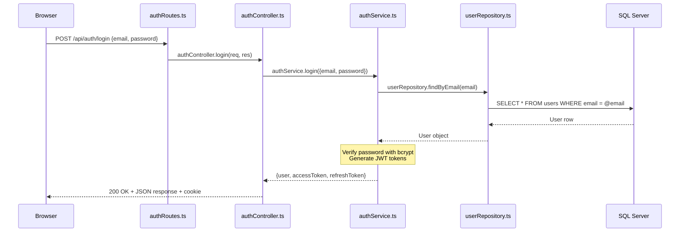

---

## 🗄️ Database Schema (8 Tables)

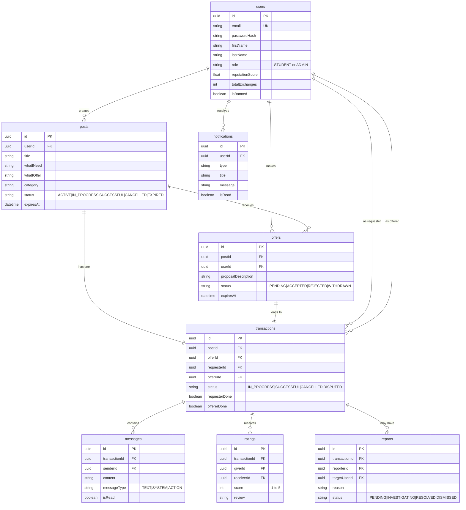

> [!NOTE]
> There's also a `leaderboard_snapshots` table that stores daily rankings of top users.

### Key Database Constraints

- **One offer per student per post**: `@@unique([postId, userId])` on the `offers` table
- **One rating per user per transaction**: `@@unique([transactionId, giverId])` on the `ratings` table
- **One transaction per post**: `postId` is `@unique` in `transactions`
- **Soft deletes**: Every table has `isDeleted` flag — records are never truly deleted

---

## ⚙️ Stored Procedures (14 Total)

Stored procedures encapsulate complex multi-step business operations **atomically** (all-or-nothing using transactions).

| # | Procedure | What It Does |
|---|-----------|-------------|
| 1 | `sp_AcceptOffer` | Accept one offer → reject all others → set post to IN_PROGRESS → create transaction (all in one atomic operation) |
| 2 | `sp_CompleteTransaction` | Mark one side done; if both sides done → set SUCCESSFUL + recalculate reputation |
| 3 | `sp_CancelTransaction` | Cancel transaction + update post status (by user or admin) |
| 4 | `sp_RecalculateReputation` | Computes reputation: `avgRating × 0.6 + normalizedExchanges × 0.4` |
| 5 | `sp_ExpirePosts` | Expire active posts past their deadline |
| 6 | `sp_ExpireOffers` | Expire pending offers past 48 hours |
| 7 | `sp_ExpireTransactions` | Expire stale transactions + their posts |
| 8 | `sp_BanUser` | Ban user + send notification |
| 9 | `sp_UnbanUser` | Unban user + send notification |
| 10 | `sp_CreateReport` | File a dispute report (validates reporter is part of transaction) |
| 11 | `sp_ResolveReport` | Admin resolves/dismisses report + notifies reporter |
| 12 | `sp_DailyLeaderboardSnapshot` | Captures top 100 users' rankings daily |
| 13 | `sp_GetDashboardStats` | Returns all admin dashboard statistics in a single query |
| 14 | `sp_CreateRating` | Creates rating + recalculates reputation + sends notification |

> [!TIP]
> **Why stored procedures?** They run inside the database engine, so multi-step operations (like accepting an offer) are **atomic** — either ALL steps succeed or NONE do. This prevents data inconsistency.

### Reputation Formula

```
reputationScore = (avgRating × 0.6) + (normalizedExchanges × 0.4)

where normalizedExchanges = MIN(exchangeCount / 50, 1) × 5
```

- 60% weight on how well others rated you
- 40% weight on how many exchanges you've completed (capped at 50)

---

## 🔐 Authentication & Security

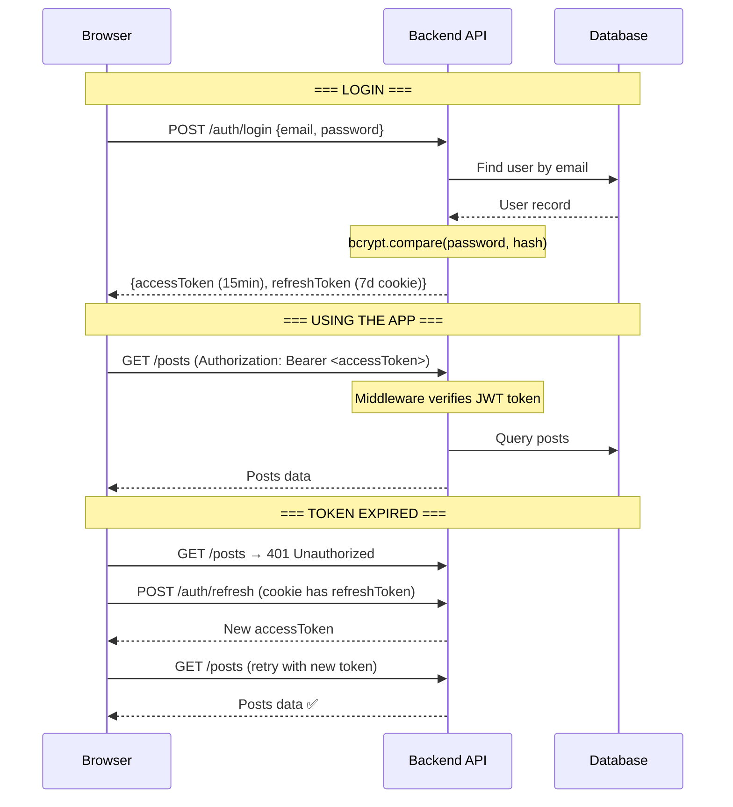

### Security Measures

| Feature | Implementation |
|---------|---------------|
| **Password hashing** | bcrypt with 12 salt rounds |
| **JWT dual tokens** | Short-lived access token (15min) + long-lived refresh token (7 days) |
| **Rate limiting** | 100 req/15min global; 10 req/15min for login/register |
| **XSS protection** | Input sanitization strips HTML from all inputs |
| **CORS** | Only allows requests from the frontend origin |
| **Helmet** | Sets security headers (CSP, HSTS, etc.) |
| **Soft deletes** | Data is never truly deleted (audit trail) |

### Middleware Pipeline

Every request passes through middleware in this order:

```
Request → Helmet → CORS → Rate Limiter → Body Parser → XSS Sanitizer → Route → Auth Middleware → Controller
```

---

## 🖥️ Frontend Architecture

### Tech Stack

| Technology | Purpose |
|-----------|---------|
| **React 18** | UI component library |
| **Vite** | Fast dev server and bundler |
| **TypeScript** | Type safety |
| **Tailwind CSS** | Utility-first styling |
| **Zustand** | Global state management (auth, notifications, UI) |
| **React Router v6** | Client-side routing with lazy loading |
| **Framer Motion** | Animations |
| **Socket.IO Client** | Real-time communication |
| **React Hook Form + Zod** | Form handling + validation |
| **Axios** | HTTP client with interceptors |

### Route Map (16 Pages)

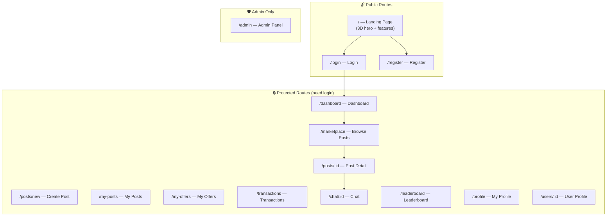

### State Management (Zustand Stores)

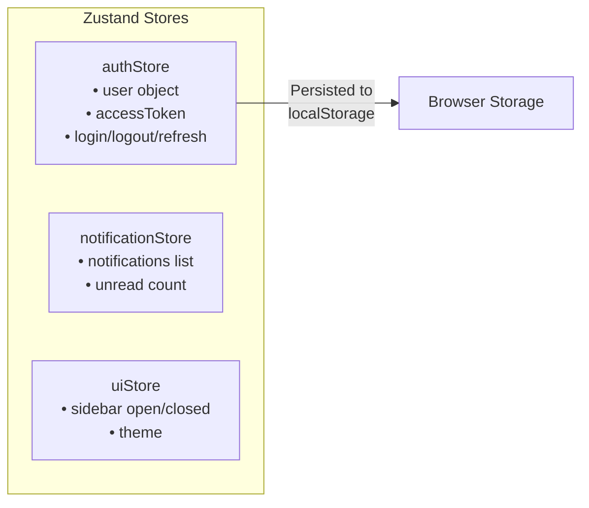

### API Client (Axios with Interceptors)

The frontend uses Axios with two important interceptors:

1. **Request Interceptor**: Automatically attaches the JWT access token to every request
2. **Response Interceptor**: If a request gets 401 (unauthorized), it automatically refreshes the token and retries the request — the user never notices

```
Frontend Page → dataService → api.ts (Axios) → Backend API
                                  ↓
                         Auto-attach JWT token
                         Auto-refresh on 401
```

---

## 🔄 Complete Exchange Flow (The Core Business Logic)

This is the **main workflow** of the entire application:

```mermaid
stateDiagram-v2
    [*] --> PostCreated: Student creates post
    PostCreated --> ACTIVE: Post goes live

    ACTIVE --> ACTIVE: Students send offers
    ACTIVE --> EXPIRED: Timer runs out (cron job)

    ACTIVE --> IN_PROGRESS: Owner accepts an offer
    Note right of IN_PROGRESS: sp_AcceptOffer runs:<br/>1. Accept chosen offer<br/>2. Reject all other offers<br/>3. Create transaction<br/>4. Chat unlocked

    IN_PROGRESS --> SUCCESSFUL: Both sides mark "Done"
    Note right of SUCCESSFUL: sp_CompleteTransaction:<br/>1. Mark complete<br/>2. Recalculate reputation<br/>3. Rating enabled

    IN_PROGRESS --> CANCELLED: Either party cancels
    IN_PROGRESS --> EXPIRED: 14-day timer runs out

    SUCCESSFUL --> [*]: Users rate each other
    CANCELLED --> [*]
    EXPIRED --> [*]
```

### Step-by-Step Walkthrough

| Step | What Happens | Who Does It | Where in Code |
|------|-------------|-------------|---------------|
| 1 | Student creates a post ("I need X, I'll give Y") | Poster | `postService.create()` |
| 2 | Other students browse marketplace and send offers | Offerers | `offerService.create()` |
| 3 | Post owner reviews offers, accepts one | Poster | `offerService.accept()` → calls `sp_AcceptOffer` |
| 4 | Transaction created, chat unlocked | System | Stored procedure creates transaction row |
| 5 | Both students chat to coordinate | Both | Socket.IO real-time messaging |
| 6 | Each student marks their side as "Done" | Both | `transactionService.markComplete()` → `sp_CompleteTransaction` |
| 7 | When both mark done → Exchange is SUCCESSFUL | System | Stored procedure updates status |
| 8 | Both students can rate each other (1-5 stars) | Both | `ratingService.create()` → `sp_CreateRating` |
| 9 | Reputation scores recalculated | System | `sp_RecalculateReputation` |

---

## 💬 Real-Time Chat (Socket.IO)

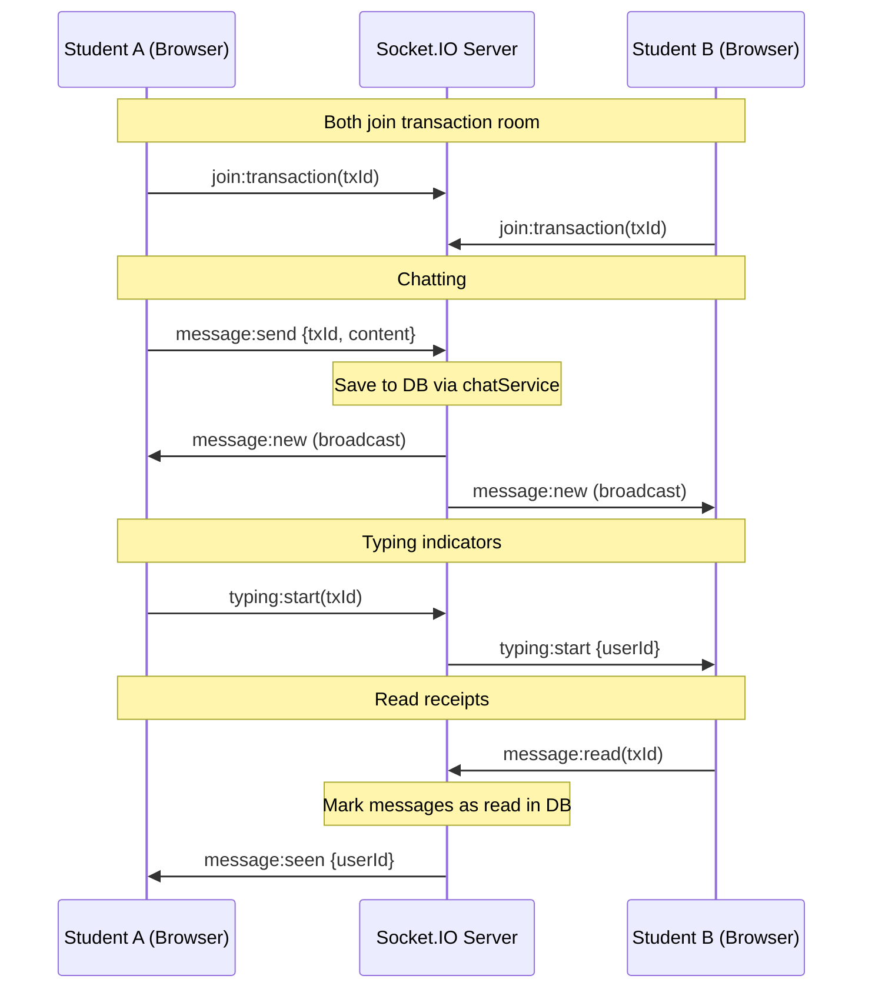

### Socket Events

| Event | Direction | Purpose |
|-------|-----------|---------|
| `join:transaction` | Client → Server | Join a chat room |
| `message:send` | Client → Server | Send a message |
| `message:new` | Server → Client | Broadcast new message |
| `typing:start/stop` | Both ways | Show typing indicator |
| `message:read` | Client → Server | Mark messages as read |
| `message:seen` | Server → Client | Notify read receipt |
| `notification` | Server → Client | Push notification to user |

---

## ⏰ Cron Jobs (Automated Tasks)

| Job | Schedule | Stored Procedure | Purpose |
|-----|----------|-----------------|---------|
| Expire Posts | Every 15 min | `sp_ExpirePosts` | Set `ACTIVE` posts past their deadline to `EXPIRED` |
| Expire Offers | Every 15 min | `sp_ExpireOffers` | Expire `PENDING` offers older than 48 hours |
| Expire Transactions | Every 30 min | `sp_ExpireTransactions` | Expire `IN_PROGRESS` transactions past 14 days |
| Leaderboard Snapshot | Daily at midnight | `sp_DailyLeaderboardSnapshot` | Save top 100 users' rankings |

---

## 🗺️ API Endpoints Summary

### Auth (No login required)
| Method | URL | Purpose |
|--------|-----|---------|
| POST | `/api/auth/register` | Create account (.edu email only) |
| POST | `/api/auth/login` | Login → get tokens |
| POST | `/api/auth/refresh` | Get new access token |
| POST | `/api/auth/logout` | Clear refresh token |

### Posts (Login required)
| Method | URL | Purpose |
|--------|-----|---------|
| GET | `/api/posts` | Browse marketplace (filter, search, paginate) |
| POST | `/api/posts` | Create new post |
| GET | `/api/posts/:id` | View post details |
| PUT | `/api/posts/:id` | Edit post |
| DELETE | `/api/posts/:id` | Delete post |

### Offers (Login required)
| Method | URL | Purpose |
|--------|-----|---------|
| POST | `/api/offers` | Send offer on a post |
| POST | `/api/offers/:id/accept` | Accept an offer (post owner only) |
| POST | `/api/offers/:id/withdraw` | Withdraw your offer |

### Transactions (Login required)
| Method | URL | Purpose |
|--------|-----|---------|
| POST | `/api/transactions/:id/complete` | Mark your side as done |
| POST | `/api/transactions/:id/cancel` | Cancel the exchange |

### Admin (Admin role required)
| Method | URL | Purpose |
|--------|-----|---------|
| GET | `/api/admin/dashboard` | Dashboard statistics |
| POST | `/api/admin/users/ban` | Ban a user |
| POST | `/api/admin/reports/resolve` | Resolve a dispute |

---

## 🔗 Database Connection Layer

The project uses a **custom database connection module** (`db/connection.ts`) instead of an ORM for queries:

```
┌─────────────────────────────────────────────┐
│  db.query`SELECT * FROM users WHERE id=${x}`│  ← Tagged template (safe from SQL injection)
│  db.execute`UPDATE users SET ...`           │  ← For INSERT/UPDATE/DELETE
│  db.callProcedure('sp_AcceptOffer', {...})   │  ← Call stored procedures
└─────────────────────────────────────────────┘
                      │
          ┌───────────┴───────────┐
          │   Driver Selection    │
          │  (automatic)          │
          ├───────────────────────┤
          │ Windows? → msnodesqlv8│  (native ODBC, supports Windows Auth)
          │ Other?   → tedious    │  (pure JS, cross-platform)
          └───────────────────────┘
```

> [!NOTE]
> **Prisma** is used only for **schema management** (creating tables via `prisma db push`). All actual queries go through the custom `db` module using raw SQL and stored procedures.

---

## 🎨 Frontend Design System

| Token | Color | Where Used |
|-------|-------|-----------|
| Background | `#0B0F14` | Page backgrounds |
| Surface | `#1F2937` | Cards, inputs |
| Primary | `#8B5CF6` | Buttons, links, accents |
| Lavender | `#A78BFA` | Subtle highlights |
| Success | `#10B981` | Confirmations |
| Danger | `#EF4444` | Errors, destructive actions |
| Warning | `#F59E0B` | Pending states |

**Design features**: Glassmorphism cards, purple glow shadows, gradient borders, Framer Motion animations, 3D Three.js hero scene on landing page.

---

## 🧑‍💼 User Roles

| Role | Can Do | Cannot Do |
|------|--------|-----------|
| **STUDENT** | Create posts, send offers, chat, rate, report | Access admin panel, ban users |
| **ADMIN** | Everything a student can + view dashboard stats, ban/unban users, resolve reports, force-cancel transactions | — |

---

## 🚀 How to Run the Project

```
1. Clone repo
2. cd backend && npm install
3. cd frontend && npm install  
4. Set up .env files (DATABASE_URL, JWT secrets)
5. Make sure SQL Server is running
6. npx prisma db push (creates tables)
7. npx tsx src/db/seed.ts (loads sample data)
8. npm run dev (in both backend/ and frontend/)
9. Open http://localhost:5173
```

**Test credentials after seeding:**
| Email | Password | Role |
|-------|----------|------|
| `admin@alchex.io` | `Test@1234` | Admin |
| `sarah@university.edu` | `Test@1234` | Student |

---

## 📋 Detailed Feature Flows (Every Feature Explained)

This section walks through **every single feature** in detail — what happens on the frontend, what happens on the backend, what database changes occur, and what notifications are sent.

---

### Feature 1: Post Lifecycle (Create → Active → Expire)

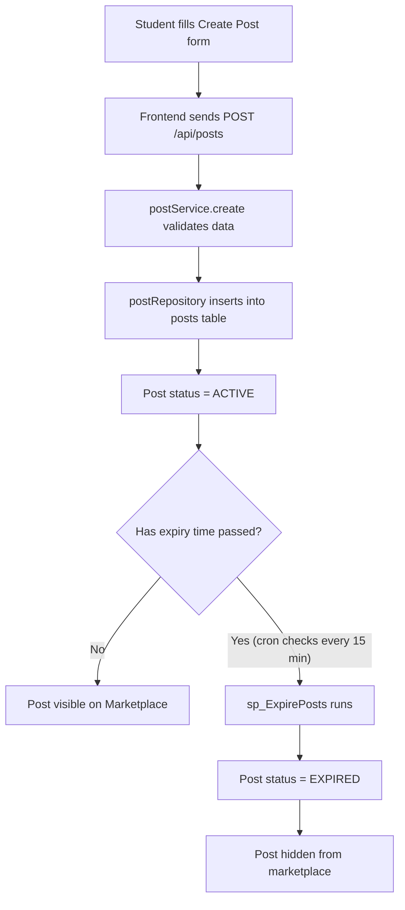

**What the student fills in:**
| Field | Description | Required? |
|-------|------------|-----------|
| Title | What they need (short) | ✅ Yes |
| Description | Detailed explanation | ✅ Yes |
| What I Need | The service/good they want | ✅ Yes |
| What I Offer | What they'll give in return | ✅ Yes |
| Category | Type of exchange (Academic, Skills, Items, etc.) | ✅ Yes |
| Tags | Keywords for searchability | ❌ Optional |

**Post statuses and what they mean:**
| Status | Meaning | How it happens |
|--------|---------|---------------|
| `ACTIVE` | Open for offers | Set when post is created |
| `IN_PROGRESS` | An offer was accepted, exchange happening | Set by `sp_AcceptOffer` |
| `SUCCESSFUL` | Both sides completed the exchange | Set by `sp_CompleteTransaction` |
| `CANCELLED` | Exchange was cancelled | Set by `sp_CancelTransaction` |
| `EXPIRED` | Time ran out | Set by `sp_ExpirePosts` (cron job every 15 min) |

**Key rules:**
- Only `ACTIVE` posts appear on the main marketplace feed
- Owner can edit/delete their post only while it's `ACTIVE`
- Once an offer is accepted, the post moves to `IN_PROGRESS` and no more offers are accepted

---

### Feature 2: Offer Flow (Create → Expire/Accept/Reject)

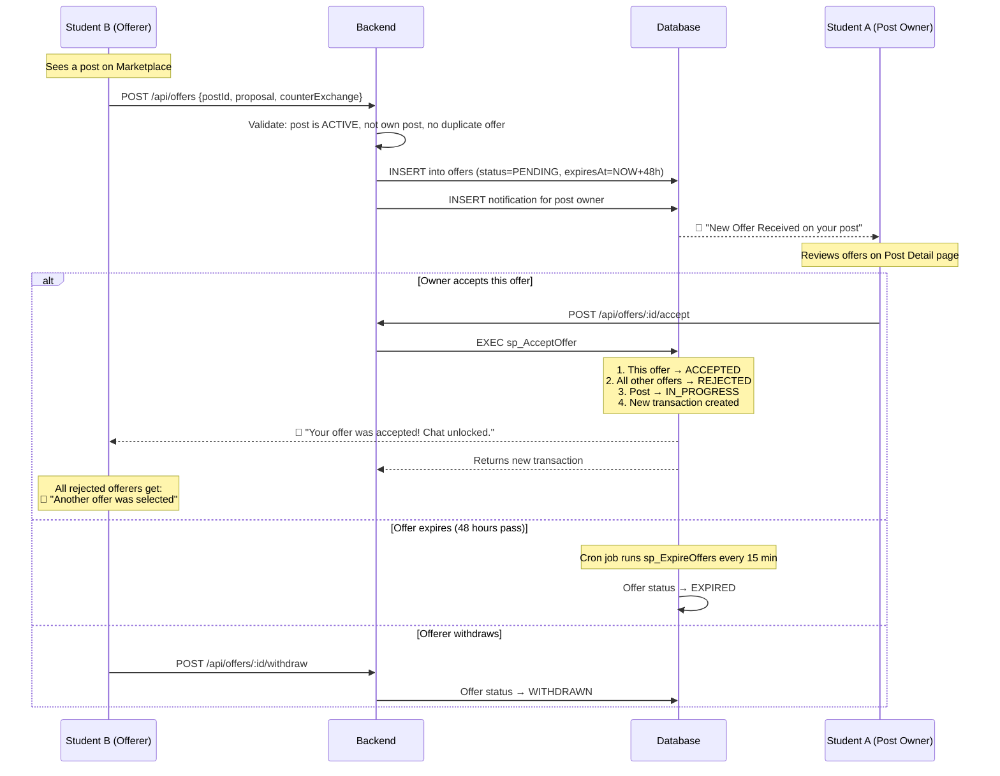

**Offer rules:**
| Rule | Implementation |
|------|---------------|
| Only 1 offer per student per post | `@@unique([postId, userId])` constraint in database |
| Offers expire after 48 hours | `expiresAt` set at creation; cron expires them |
| Can only offer on `ACTIVE` posts | Service validates `post.status === 'ACTIVE'` |
| Can't offer on your own post | Service checks `post.userId !== userId` |
| Offerer can edit while `PENDING` | Frontend shows "Edit Offer" button |
| Countdown timer shown on UI | `OfferCountdown` component shows time remaining |

**What gets notified:**
| Event | Who gets notified | Notification message |
|-------|------------------|---------------------|
| New offer submitted | Post owner | "You received a new offer on [post title]" |
| Offer accepted | The accepted offerer | "Your offer was accepted! Chat unlocked." |
| Offer rejected (another accepted) | All rejected offerers | "Another offer was selected for [post title]" |

---

### Feature 3: Transaction Flow (The Complete Exchange Process)

This is the **most important flow** — it's what happens after an offer is accepted.

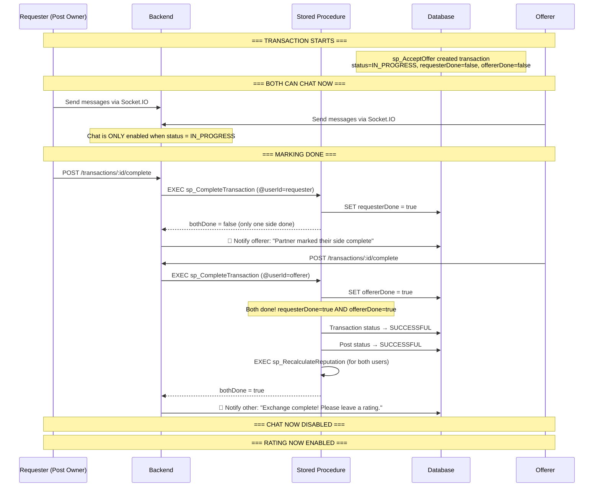

**Transaction statuses:**
| Status | Meaning | Chat? | Can Rate? |
|--------|---------|-------|-----------|
| `IN_PROGRESS` | Exchange is ongoing | ✅ **Enabled** | ❌ No |
| `SUCCESSFUL` | Both marked done | ❌ **Disabled** — shows "Transaction Completed. Chat Disabled" | ✅ **Yes** |
| `CANCELLED` | Someone cancelled | ❌ **Disabled** — shows "Transaction Cancelled. Chat Disabled" | ❌ No |
| `EXPIRED` | 14-day limit reached | ❌ **Disabled** | ❌ No |

**How chat gets disabled (from the code):**
```
canSendMessages = selectedTx?.status === 'IN_PROGRESS'
// Only IN_PROGRESS transactions allow sending messages
// Input field is disabled and shows "Chat disabled for this transaction"
```

**How "Mark Done" works:**
1. Each side has a `requesterDone` and `offererDone` boolean flag
2. When you click "Mark Done", YOUR flag gets set to `true`
3. The other person gets a notification: "Partner marked their side complete"
4. When the OTHER person also clicks "Mark Done", BOTH flags are `true`
5. The stored procedure detects `bothDone` and sets status to `SUCCESSFUL`
6. Both users' reputation scores are recalculated

**Cancel flow:**
- Either party can click "Cancel" while transaction is `IN_PROGRESS`
- Calls `sp_CancelTransaction` → sets transaction AND post to `CANCELLED`
- Other party gets notification: "The exchange has been cancelled by the other party"
- Chat becomes disabled immediately

---

### Feature 4: Rating & Reputation System

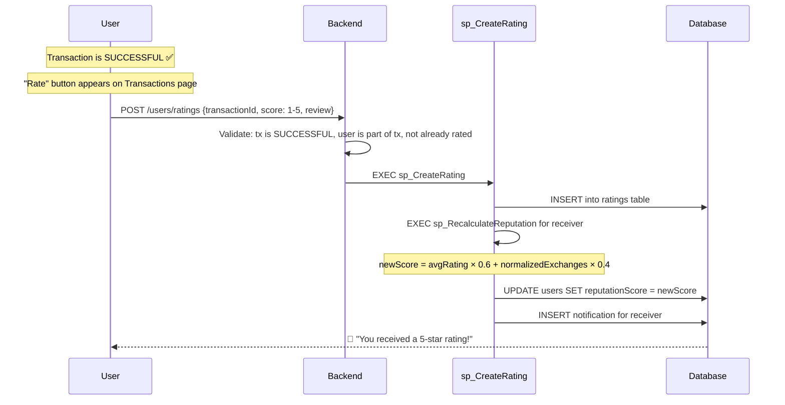

**Rating rules:**
| Rule | How it's enforced |
|------|------------------|
| Can only rate `SUCCESSFUL` transactions | Service checks `transaction.status === 'SUCCESSFUL'` |
| Only 1 rating per person per transaction | `@@unique([transactionId, giverId])` in database |
| Score must be 1-5 | Validated in stored procedure `IF @score < 1 OR @score > 5` |
| Both parties can rate each other | Receiver is automatically the "other" user |
| Rating shown on profile | Profile page shows rating breakdown and average |

**After rating — what shows on the UI:**
- Transactions page shows "✓ Rated" badge next to transactions you've already rated
- The "Rate" button disappears after you submit
- Receiver's profile updates with new reputation score

---

### Feature 5: Notification System (All Trigger Points)

Every notification is stored in the `notifications` table and pushed in real-time via Socket.IO.

| Trigger Event | Notification Type | Who Receives | Message |
|--------------|------------------|-------------|---------|
| New offer on your post | `OFFER_RECEIVED` | Post owner | "You received a new offer on [title]" |
| Your offer is accepted | `OFFER_ACCEPTED` | Offerer | "Your offer on [title] was accepted. Chat unlocked." |
| Another offer chosen | `OFFER_REJECTED` | Rejected offerers | "Another offer was selected for [title]" |
| Partner marks done | `TRANSACTION_COMPLETE` | Other party | "Your exchange partner marked their side complete" |
| Both sides done | `TRANSACTION_COMPLETE` | Other party | "Exchange complete! Please leave a rating." |
| Transaction cancelled | `SYSTEM` | Other party | "The exchange has been cancelled by the other party" |
| You get rated | `RATING_RECEIVED` | Rating receiver | "You received a 5-star rating!" |
| Account banned | `SYSTEM` | Banned user | "Your account has been suspended. Reason: [reason]" |
| Account unbanned | `SYSTEM` | Unbanned user | "Your account has been reinstated." |
| Report resolved | `REPORT_UPDATE` | Reporter | "Your report has been resolved/dismissed." |
| Admin force-cancel | `SYSTEM` | Both parties | "An admin has cancelled this exchange." |

**How notifications work in the frontend:**
1. On login, Socket.IO connection is established
2. User joins their personal room `user:{userId}`
3. Backend emits `notification` event to that room
4. `notificationStore` in Zustand updates the unread count
5. Header bell icon shows unread badge
6. User can mark individual or all notifications as read

---

### Feature 6: Reporting & Dispute Handling

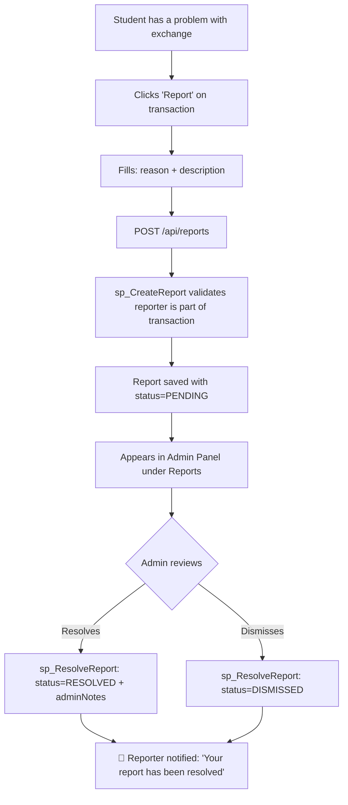

**Report statuses:** `PENDING` → `INVESTIGATING` → `RESOLVED` or `DISMISSED`

---

### Feature 7: Leaderboard

- Shows top students ranked by reputation score
- Rankings = weighted combination of ratings (60%) and exchange count (40%)
- Cron job runs `sp_DailyLeaderboardSnapshot` at midnight daily
- Captures top 100 users' stats into `leaderboard_snapshots` table
- Frontend shows podium with gold/silver/bronze crowns for top 3
- Can filter by time period (All-time, Monthly, Weekly)

---

### Feature 8: Admin Panel

The admin panel (`/admin`) is **only accessible to users with role = ADMIN**.

| Section | What admin can do | Backend code |
|---------|------------------|-------------|
| **Dashboard** | View stats (total users, posts, transactions, pending reports) | `sp_GetDashboardStats` — single query returns all stats |
| **User Management** | Search users, ban/unban them | `sp_BanUser` / `sp_UnbanUser` |
| **Reports** | View pending reports, resolve or dismiss with notes | `sp_ResolveReport` |
| **Force Cancel** | Cancel any in-progress transaction | `sp_CancelTransaction` with `@isAdmin=1` |

**Route protection:** The `/admin` route is wrapped in `AdminRoute` component which checks `user.role === 'ADMIN'` — non-admins are redirected to `/dashboard`.

---

### Feature 9: User Profile

Each user profile displays:
- **Avatar** (initials-based gradient circle)
- **Basic info**: name, email, batch, program, section, university, campus
- **Bio** and optional social links
- **Reputation score** (calculated by stored procedure)
- **Total exchanges** completed
- **Rating breakdown**: average rating + distribution chart (1-5 stars)
- **Post history**: all posts created by user

Students can edit their own profile (name, bio, university info, social links).

---

### Feature 10: Landing Page (3D Alchemy Hero)

The public landing page (`/`) features:
- **3D hero scene** using React Three Fiber (Three.js) — animated alchemy circle
- **Floating particles** for immersive effect
- **Animated stats** (total exchanges, active users)
- **How It Works** section (step-by-step guide)
- **Feature grid** showcasing platform capabilities
- **Leaderboard teaser** showing top contributors
- **Call-to-action** buttons to Register / Login

---

### Complete Feature Flow Visualization

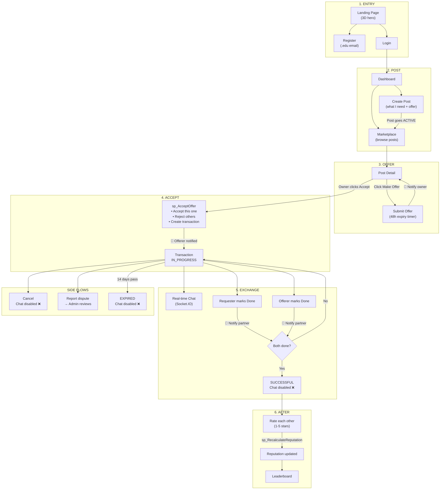

---

## 📊 Key Design Decisions Summary

| Decision | Why |
|----------|-----|
| **Layered architecture** (Controller→Service→Repository) | Separation of concerns, testability, maintainability |
| **Stored procedures for critical operations** | Atomicity — multi-step DB operations can't partially fail |
| **JWT dual-token auth** | Short access token limits damage if stolen; long refresh token keeps users logged in |
| **Soft deletes everywhere** | Audit trail, data recovery, referential integrity |
| **Socket.IO for chat** | Real-time bidirectional communication without polling |
| **Cron jobs for expiry** | Automatic cleanup without user intervention |
| **Zustand for state** | Simpler than Redux, built-in persistence to localStorage |
| **Lazy-loaded routes** | Faster initial page load — only loads code when needed |
| **Rate limiting** | Prevents brute force attacks on login/register |

---

## 🧩 Normalization Level

The database is normalized to **BCNF (Boyce-Codd Normal Form)**:
- Every table has a single primary key (UUID)
- No repeating groups
- No partial dependencies  
- No transitive dependencies
- Every determinant is a candidate key

**Indexes** are placed on frequently queried columns (email, status, foreign keys, timestamps) for performance.

---

> **Good luck with your evaluation! 🎓**
